<div align="center">

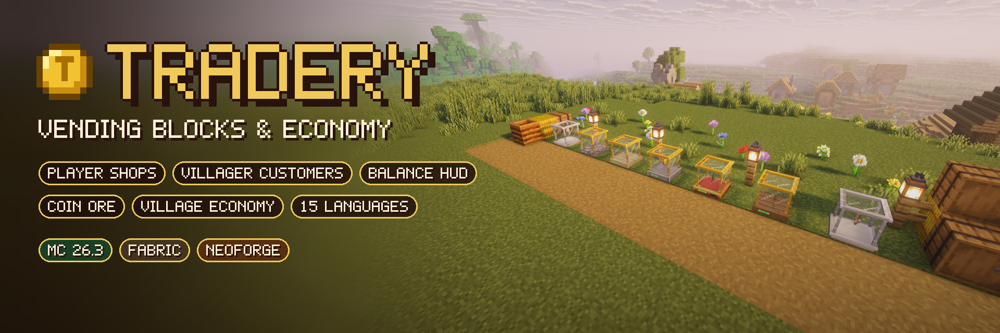

# Tradery

Vending blocks, a currency with your balance on screen, and villages that buy, sell and grow with it.

Minecraft 1.20.1 · Fabric and Forge · also on 26.3 and 1.21.1

[](https://www.minecraft.net/)
[](https://fabricmc.net/)
[](https://files.minecraftforge.net/)
[](docs/api/README.md)
[](LICENSE)

</div>

Tradery adds shops that keep selling while you're away. You place a vending block, fill it with goods and set a price, and anyone who passes can buy. The price is either items, the way the old Vending Block mod did it, or money in the server's currency. Your balance is always in a corner of the screen.

Money enters the world through coin ore, mob rewards and villagers, and leaves it through fees and village projects. Since 1.1 villagers take part in that: they carry wallets, walk to players' stalls to buy what they need, sell what they produce to players who run buyback blocks, and every village keeps a treasury that pays for orders and buildings. A village grows because players trade with it. All of this works in single-player too.

**Contents:** [Installing](#installing) · [Your first shop](#your-first-shop) · [Money](#money) · [Vending blocks](#vending-blocks) · [Villagers](#villagers) · [Villages](#villages) · [Commands](#commands) · [Configuration](#configuration) · [Compatibility](#compatibility) · [For developers](#for-developers) · [FAQ](#faq)

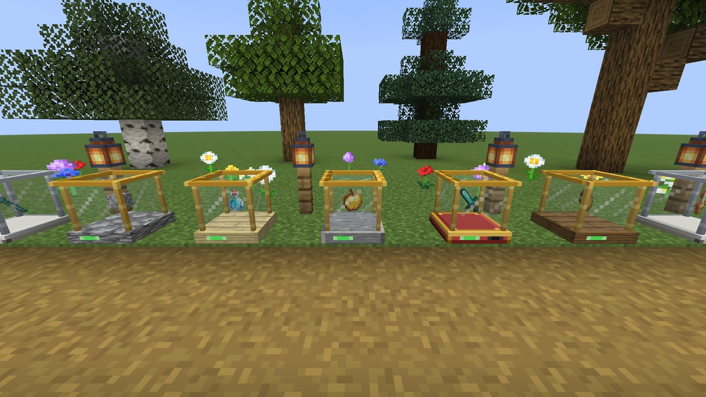

## Installing

| | Fabric | Forge |
|---|---|---|
| Minecraft | 1.20.1 | 1.20.1 |
| Loader | Fabric Loader 0.16.10 or newer, with [Fabric API](https://modrinth.com/mod/fabric-api) | Forge 47 |
| Java | 17 | 17 |

Install it on the server and on every client: the mod adds blocks, items and screens, so a vanilla client can't join. Nothing else is required. The optional mods it works with are listed under [Compatibility](#compatibility).

The 26.3, 1.21.1 and 1.20.1 versions have the same features. On 1.20.1 the vending block's lamp glows on Forge only.

## Your first shop

1. Craft a vending block: glass on top and on both sides of a chest, three gold ingots underneath.
2. Place it and right-click it. As the owner you get the owner screen.
3. Put one item of what you want to sell in the goods slot. It's a sample and stays there; set how many go in one sale (1 to 64).
4. Choose the price. Type an amount for money, or switch to an item price and put a sample of the payment item in the price slot.
5. Put your stock in the 27 storage slots and close the screen.

Other players right-click the block to buy one sale, eight, or as many as they can pay for and carry. Sneaking and right-clicking buys one sale without opening anything; hold the button and it keeps buying, about five sales a second.

Money from a sale goes to your balance at once, minus a 2% fee that is destroyed. Item payments wait in the block's 9 revenue slots; when those are full the block stops selling and tells you. You get a chat line for each sale while you're online and a summary of what sold while you were away when you join.

| Buyer screen | Owner screen |
|---|---|
| 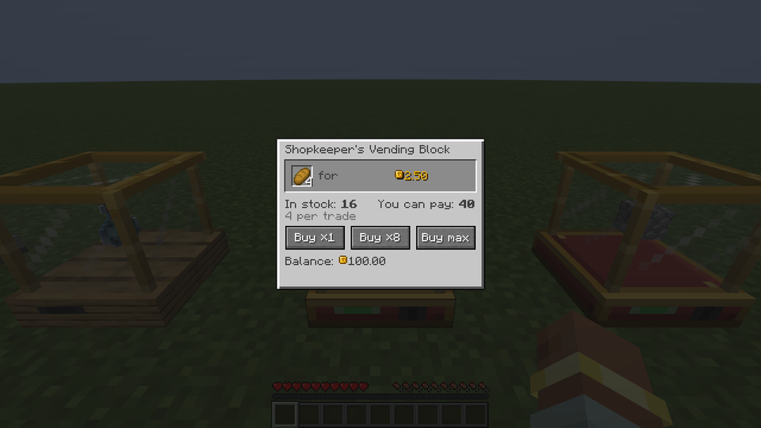 | 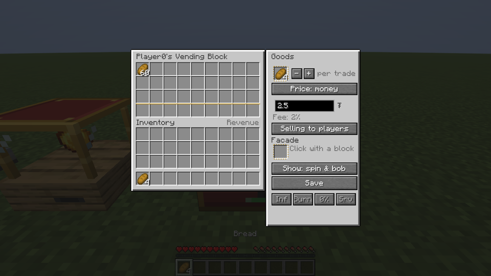 |

## Money

Every player has an account in the server's currency. New accounts start with 100.00 ₮. The name, the symbol and the number of decimals are set in `server.json5`; amounts are stored as whole minor units (cents, with two decimals), so nothing gets lost to rounding. The number of decimals is fixed for a world the first time it starts.

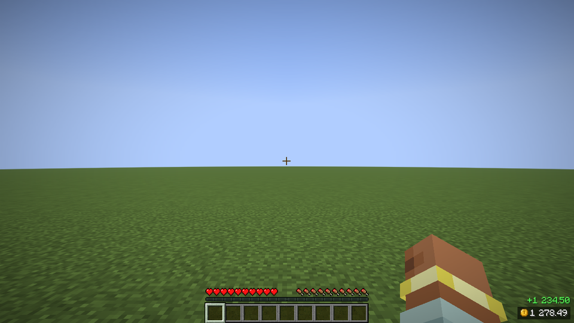

The balance sits in a corner of the screen with a coin icon. It rolls to new values and shows each change as a short green or red line. You can move it to any corner, scale it from 0.5 to 2, switch between `1 250.00` and `1.2K`, or hide it with `/tradery hud` or a key you bind yourself.

### Where money comes from

**Coin ore.** Three tiers, each in stone and deepslate. Mining it with a fitting tool in survival puts the coins' value straight on your balance; nothing drops. Ore broken by a machine or an explosion drops coin items instead, and picking one up deposits it.

| Ore | Height | Veins per chunk | Coins per block | Value of a coin |
|---|---|---|---|---|
| Copper coin ore | Y 0 to 96 | 6 | 1 to 3 | 1 ₮ |
| Silver coin ore | Y −32 to 32 | 3 | 1 to 2 | 10 ₮ |
| Gold coin ore | Y −64 to −16 | 1 | 1 | 100 ₮ |

Fortune does nothing to coin ore by default, and the ore is not tagged as an ore for other mods, so crushers and ore processors can't multiply it. Silk Touch gives you the ore block, which pays when you mine it later. Coins are also items you can carry: right-click to deposit them, `/tradery withdraw` turns balance back into coins, and item-priced vending blocks accept them like any other item. Ore placement, coin values and an optional daily cap are configurable.

**Mob rewards.** Hostile mobs pay when a player kills them, for example 1 to 3 ₮ for a zombie or skeleton, 2 to 4 for a creeper, 3 to 6 for a witch or an enderman, 100 to 150 for the warden. Mobs from spawners and trial spawners pay nothing, neither do kills by fake players such as Create's Deployer. After 20 kills within a minute rewards are halved, and one player can earn at most 1 000 ₮ a day from rewards. Rewards for mining, crafting, fishing and advancements exist but are off by default.

**Villagers.** Villagers pay for what they buy at players' stalls, pay out in the trade window, and villages pay rewards for orders. Their money is limited by wallets and daily caps, described under [Villagers](#villagers).

### Where money goes

- 2% of every money sale at a vending block.
- What players pay into village projects and donations.
- Rent for trading places in villages.
- Server-owned vendors, such as the ones on village markets, destroy what they take.
- A `/pay` tax, 0% by default.

`/eco stats` shows how much money exists, and how much was created and destroyed today and this week, so a server owner can see whether the economy is inflating.

## Vending blocks

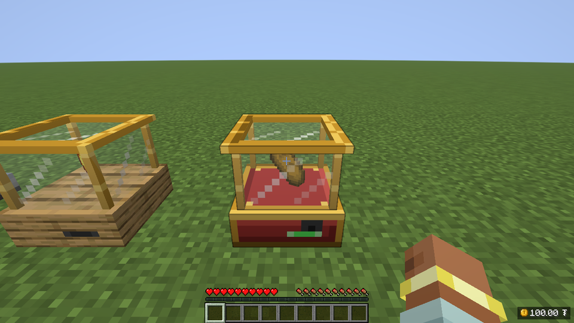

A vending block holds one offer: a number of one item for a price. Items are compared exactly, including their name, enchantments and damage, so a renamed or enchanted sword doesn't count as a plain one, both for the goods and for an item price.

**Buyback.** Switch a money-priced block to buying and it buys the goods from other players with your money, as long as you can pay and there's room in its storage. Players sell to it by sneaking and left-clicking, or through its screen.

**Quick trade.** Sneak + right-click buys one sale from a selling block, sneak + left-click sells one to a buying block. Holding the button repeats it. The owner's own sneak-clicks act like vanilla, so you can still break your block.

**The hint.** Looking at a vending block shows its owner, goods and price at the top of the screen, which keys to press, or why it can't trade right now (sold out, no room, not set up). Sneak to see the items' full tooltips. When Jade is installed the hint is off by default, because Jade shows the same lines.

| Quick trade: 20 bread in one hold | Hint while sneaking |
|---|---|
| 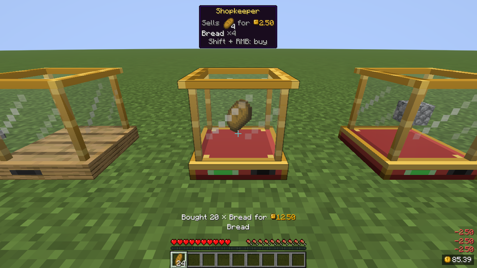 | 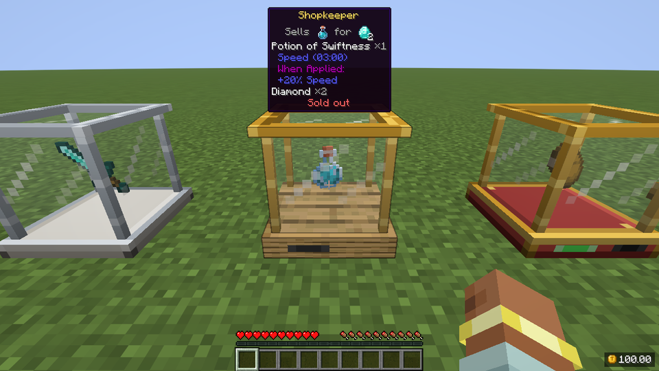 |

**Looks.** Click the base with any full block in the owner screen and the vending block takes that block's look. The goods on display can spin, bob, both, stand still or be hidden; the server sets the default and each player can override it. The display block is a glass case that shows an item and sells nothing.

**Protection.** Only the owner and operators can break a vending block. Explosions don't destroy it, pistons don't move it, and it has no inventory that hoppers or pipes can reach. Every sale checks stock, payment and room on both sides before anything moves, so a sale either happens completely or not at all.

**Market counter.** A stall with up to six offers, each with its own goods and price, selling from one shared stock of 27 slots. Craft it from two wooden slabs around a gold ingot over planks around a chest.

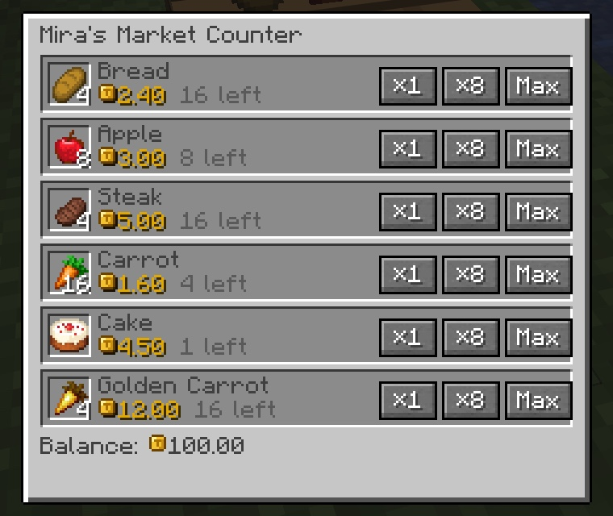

**Shop ledger.** A book and a gold ingot, or `/tradery shops`. It lists all your vending blocks and counters wherever they are: what they sell, the price, the stock, revenue waiting in them and what needs attention. Shops in unloaded chunks show their last known state. "Show" puts a beam of light over one for 30 seconds.

**Server vendors.** With the vendor key (creative only) an operator can give a block to the server, give it infinite stock and make it destroy its payments instead of keeping them. Village market stalls are built from these.

## Villagers

### Villagers as customers

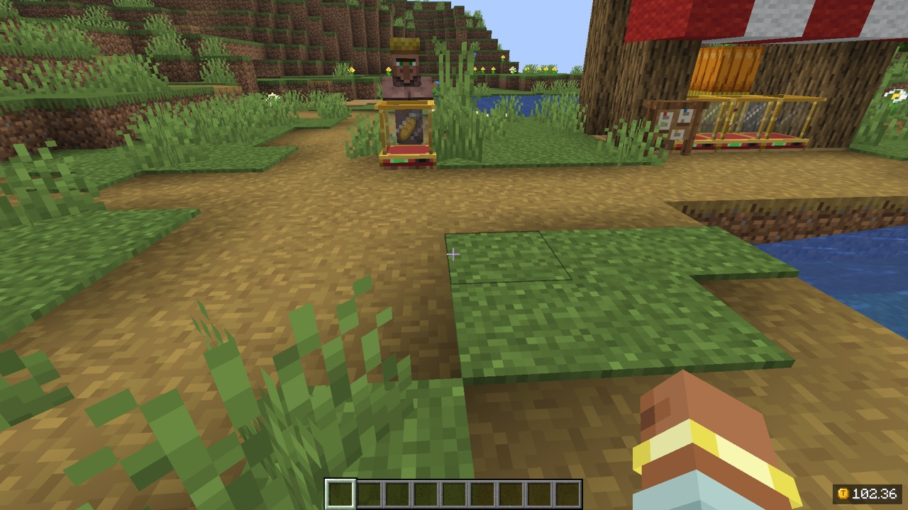

Every five seconds the server looks at the loaded vending blocks that belong to players, sell for money, have stock and have "Villagers can buy" switched on (it is by default). For each one it rolls a chance (25% by default) to call one villager from within 32 blocks. The villager must be an adult with a bed and a workstation, awake, not panicking and not trading with someone. It walks to the front of the block, looks at the goods for three seconds and decides. A villager that can't get there within 30 seconds gives up, and after a visit it won't come back for five minutes.

What it buys comes from a data pack of needs: everyone buys food, farmers buy bone meal and hoes, fishermen fishing rods and string, librarians paper and books, and so on. Whether it buys depends on the price per item compared with that item's fair price, also from a data pack:

- At or below the fair price it buys.
- Between the fair price and 1.5 times it, the chance falls evenly to zero.
- Above 1.5 times, or for items without a fair price, it never buys.

Each sale lowers the village's demand for that item by 5%, and demand recovers by 25% a day, so selling the same thing to one village all day stops working. A villager takes up to three sales per visit, as far as its wallet, your stock and the demand allow. Selling at a fair price makes villagers like you (vanilla gossip), which brings more visits and the usual vanilla discounts. Pricing at 1.25 times the fair price or more does the opposite.

### Villagers' wallets

A villager's wallet refills once a day by profession level and holds at most three days of pay.

| Profession level | Pay per day |
|---|---|
| None, or nitwit | 1 ₮ |
| Novice | 3 ₮ |
| Apprentice | 5 ₮ |
| Journeyman | 8 ₮ |
| Expert | 12 ₮ |
| Master | 18 ₮ |

Pay is multiplied by the village's level (up to ×2), and one village can spend at most 200 ₮ a day at stalls (more at higher levels). Money players pay villagers in the trade window goes into their wallets on top of that and is spent at stalls later. A villager you level up by trading becomes a richer customer.

### Trading with villagers for money

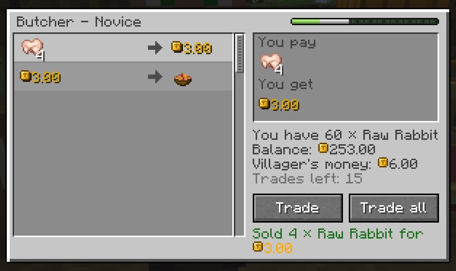

Right-clicking a villager opens Tradery's trade window instead of the vanilla one. The offers are the same, with the same levels, use limits, discounts and Hero of the Village prices, but every emerald in an offer is shown and paid as money: 3.00 ₮ by default. What you pay goes into the villager's wallet; what the villager pays you comes out of it. When the wallet is empty the villager asks you to come back tomorrow. "Trade all" repeats an offer while money, items and uses last. 10% of what players pay villagers goes to the village's treasury.

Emeralds stay an item. You can exchange them at a village market's changer, use them as an item price, or trade them with wandering traders, which still take emeralds. To keep the vanilla window, set `villagerTrading.enabled` to `false`.

### Villagers as suppliers

Switch "Villagers can sell" on a buyback block and villagers bring it what they produce: crops from farmers, fish from fishermen, wool from shepherds, stone from masons and so on. A villager produces a set amount a day by profession and level and keeps at most two days of it. It sells to your block if you pay at least 80% of the item's fair price there, up to two sales per visit, paid from your balance into its wallet.

## Villages

### A village is its bell

Tradery counts the villagers who meet at a bell as one village and checks every 30 seconds on loaded bells: how many adults live there, how many have a job, which professions, and the village type. Nothing is simulated in unloaded chunks; daily income and decay are worked out when the village is next loaded, by the number of in-game days that passed.

Looking at a bell shows the village's name, level, prosperity and next market day. Entering a village shows its name and level at the top centre of the screen for a few seconds, away from the corners where minimaps sit.

### Prosperity and levels

A village earns prosperity points from the money moving through it, and loses 5% of them every day:

| What happened | Points |
|---|---|
| Villagers spent 1 ₮ at players' stalls | 1 |
| Players finished orders worth 1 ₮ | 1 |
| 1 ₮ changed hands in the villager trade window | 0.5 |
| Villagers sold 1 ₮ of produce to players | 0.5 |
| Players funded projects or donated 1 ₮ | 0.5 |
| A villager died (killed by a player) | −1% (−3%) |

| Level | Points | Villager pay | Orders a day | Market day every | Village spending cap | Unlocks |
|---|---|---|---|---|---|---|
| Hamlet | 0 | ×1 | 3 | 7 days | ×1 | |
| Village | 300 | ×1.25 | 4 | 5 days | ×1.5 | the well, level 2 projects |
| Town | 1 500 | ×1.5 | 5 | 4 days | ×2 | caravans, festivals, the watchtower, the trading yard |
| Trade city | 5 000 | ×2 | 6 | 3 days | ×3 | the trade hall |

### The treasury

Each day the treasury gains 1.00 ₮ per villager times the level's pay multiplier, and it fills up to seven days of that income. On top of that, without a limit, come 10% of what players pay villagers in the trade window, rent for trading places and donations. The treasury pays the rewards for orders and the purses of caravans. The village board shows the last seven days of money in and out.

### The village board

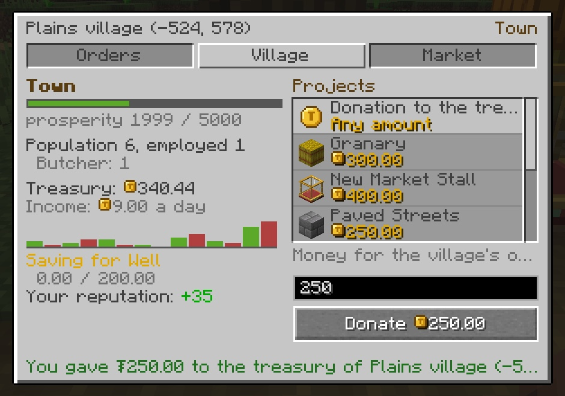

Craft a village board from three planks over paper, a sign and paper, and place it within 48 blocks of a bell; boards also generate on village market stalls. It has three tabs:

- **Orders:** what the village wants delivered, how many, what it pays.
- **Village:** level, prosperity, people and professions, the treasury and its week, what the village is saving for, your reputation, projects and donations.
- **Market:** what's cheap and dear here, the next market day, trading places and caravans.

### Orders

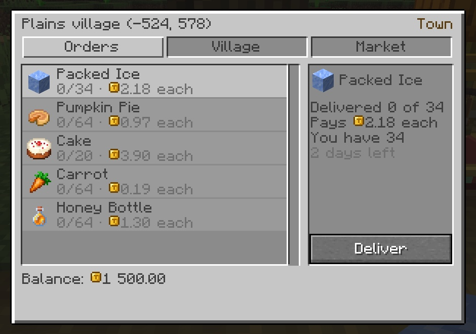

Every morning a village posts orders, three to six depending on its level, for things its professions need or its region lacks, 8 to 64 items each. An order pays the fair price times 1.3, adjusted for the region, and is posted only when the treasury can cover it; the money is set aside at once. Players deliver plain items (no name, enchantments or damage) through the board, all at once or in parts, and are paid for what they deliver. Orders are shared by all players and last two days; what's left of an expired order goes back to the treasury.

### Projects

Players can pay for projects from their own balance. The money is destroyed (a donation goes into the treasury instead), the village gains prosperity and its villagers remember who paid. Each project can be funded once per village, and most of them put up a building in the village's style:

| Project | Cost | Level | What appears | What it does |
|---|---|---|---|---|
| Street Lamps | 150 | Hamlet | Street lights along every dark street | Customers come 10% more often |
| Granary | 300 | Hamlet | A granary | The treasury holds 50% more, wallets one more day |
| Paved Streets | 250 | Village | Stone streets through the whole village | Customers come 5% more often |
| Workshops | 500 | Village | A workshop with job site blocks | Villagers' pay and the treasury's income ×1.2 |
| Watch Post | 600 | Village | A wooden lookout and an iron golem | Raids cost half as much |
| New Market Stall | 400 | Village | A market stall with three server vendors | |
| Trading Yard | 1 000 | Town | A fenced yard under an awning | Caravans leave a day sooner, market days come a day earlier |
| Donation | any | Hamlet | | All of it goes into the treasury |

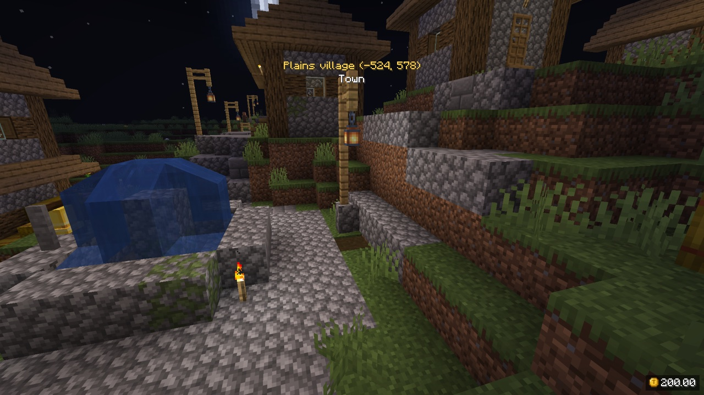

Buildings go where a village house could stand: on a flat spot of real ground near the bell, never on a roof or inside a house, next to a street when there is one, facing the bell. Each gets a path to the nearest street. If there's no room, nothing is charged.

Street lights are a wall base, a fence post in the village's wood (sandstone walls in the desert) and an arm that holds a lantern over the road, with three free blocks underneath. They go along every street that is still dark, at least ten blocks apart, and skip streets that vanilla lamp posts or torches already light. Paving turns every dirt path of the village into stone in its style and fills single-block dips and gaps. Both keep going once a day, so parts of the village loaded later get theirs too.

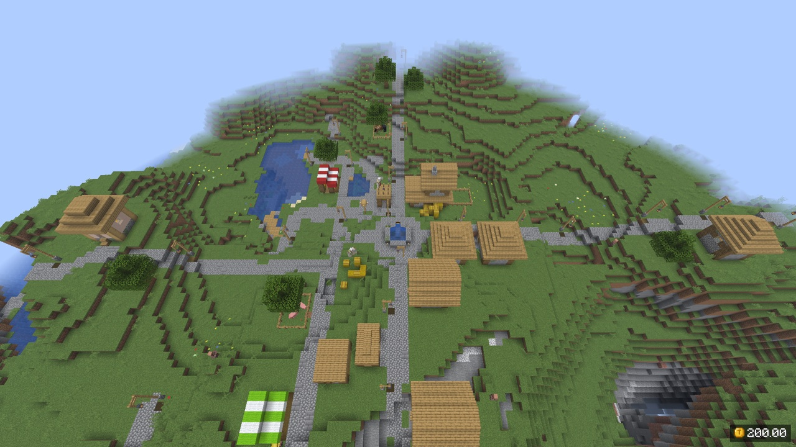

### The village builds for itself

Once a village reaches a level with a building it doesn't have yet, half of its daily income goes into a building fund instead of the treasury. When the fund covers the cost, the village builds it by the bell under the same rules as projects, and players nearby get a message.

| Building | Level | Cost |
|---|---|---|
| Well, with a sign bearing the village's name and a banner in its colour | Village | 200 |
| Watchtower | Town | 600 |
| Trade hall with three server vendors and a board | Trade city | 1 500 |

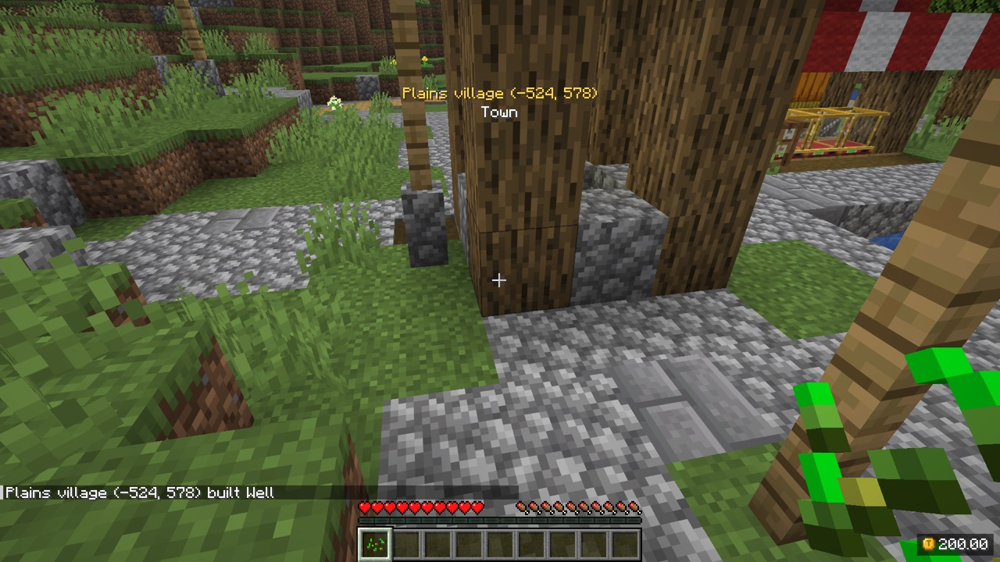

### Market days and festivals

Every few days, depending on the level, a village holds a market day: villagers visit stalls three times as often, the village may spend twice as much, and caravans that are due arrive that day. Players who come within 64 blocks of the bell that day get a chat message.

In a Town or a Trade city the market day ends with a festival at dusk. The bell rings, every villager of the village gets a day's pay on top of its wallet, the village gains 25 prosperity, and fireworks go up by the bell until night.

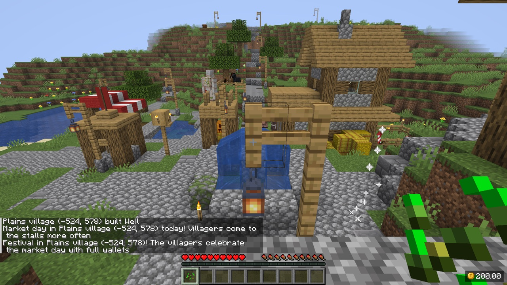

### Trading places

On the Market tab you can rent a trading place for seven days, at 5, 10, 20 or 40 ₮ a day depending on the village's level; the rent goes into the treasury. While it lasts, that village's villagers come to your vending blocks nearby from one and a half times as far and one and a half times as often.

### Regional prices and caravans

Each village type sells some goods cheap and pays more for others. Desert villages have cheap sand, sandstone, cactus and terracotta and pay more for logs, wool and fish; plains villages have cheap hay, oak logs and apples; taiga villages have cheap spruce, sweet berries, pumpkins and salmon. These factors change what villagers there pay at stalls, what orders pay and what suppliers accept.

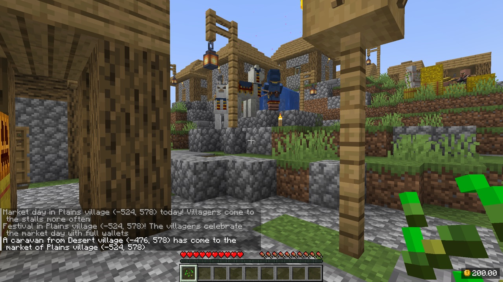

A Town sends a caravan every three days to a known village of another type up to 1 500 blocks away. It shows up there as a trader with llamas named after its home village, sells the cheap goods of its home and buys what is dear at its destination, all for money, from a purse taken out of its home village's treasury. It stays ten minutes and takes what's left of the purse home.

### Raids

A raid lost at a village costs it 30% of its prosperity, half its treasury and half of its villagers' money; with the Watch Post each of those losses is halved. A raid won brings 100 prosperity and restoration orders for planks, glass, cobblestone and torches that pay one and a half times the usual reward for three days.

### Village markets

Newly generated plains, desert, savanna, taiga and snowy villages can have market stalls. Each has two or three server vendors selling things like enchanted books, name tags, saddles, maps and rare seeds for money. A changer stall sells emeralds for 3.00 ₮ and buys them for 2.00 ₮. Only operators can break market stalls. Chunks generated before the mod was installed don't get stalls.

## Commands

| Command | What it does | Permission | Default |
|---|---|---|---|
| `/bal [player]`, `/balance` | Your balance, or someone else's | `tradery.balance`, `tradery.balance.others` | everyone, op 2 |
| `/pay <player> <amount>` | Pay a player, online or offline | `tradery.pay` | everyone |
| `/baltop [page]` | Richest players | `tradery.baltop` | everyone |
| `/tradery history [page]` | Your last transactions | `tradery.history` | everyone |
| `/tradery withdraw <amount>` | Turn balance into coins | `tradery.withdraw` | everyone |
| `/tradery shops` | Your shops in the shop ledger window | `tradery.shops` | everyone |
| `/tradery hud` | Show or hide the balance | | everyone |
| `/eco give\|take\|set <player> <amount>` | Change a balance | `tradery.admin.eco` | op 2 |
| `/eco lock\|unlock <player>` | Freeze an account | `tradery.admin.eco` | op 2 |
| `/eco stats` | Money supply, created and destroyed today and this week | `tradery.admin.stats` | op 2 |
| `/tradery vendors [player]` | Vending blocks with clickable coordinates | `tradery.admin.vendors` | op 2 |
| `/tradery reload` | Reload the configs | `tradery.admin.reload` | op 3 |

Amounts are typed in normal units: `/pay Steve 12.50`. Permission nodes work with LuckPerms or any mod that implements fabric-permissions-api or Forge's PermissionAPI.

## Configuration

Configs are JSON5 files with comments in `config/tradery/`:

- `server.json5`: the currency, starting and maximum balance, `/pay`, vending fees and limits, coin ore, villagers, markets and villages.
- `rewards.json5`: rewards per mob, block, item or advancement (ids, `#tags` or `*`) and the rules against farms.
- `client.json5`: each player's balance display, hints, village title and notifications.

A value that can't be read falls back to its default with a line in the log, and unknown keys are reported too. `/tradery reload` applies changes without a restart.

These are the settings people ask about most:

| Setting | Default | |
|---|---|---|
| `currency.symbol`, `currency.decimals` | `₮`, `2` | Decimals are fixed for a world once it has started |
| `economy.startingBalance` | `100` | |
| `economy.maxBalance` | `1000000000` | |
| `pay.taxPercent`, `pay.minAmount` | `0`, `1` | |
| `vending.feePercent` | `2` | Destroyed, not paid to anyone |
| `vending.maxPerPlayer` | `0` | 0 means no limit |
| `vending.itemBlacklist` | `["minecraft:bedrock"]` | Items that can't be sold or used as a price |
| `ore.directToBalance` | `true` | `false` drops coin items instead |
| `ore.dailyCap` | `0` | Per player, 0 means no cap |
| `ore.inflationDamping.enabled` | `false` | Fewer coins from ore while there's a lot of money around |
| `villagers.enabled` | `true` | Villagers as customers and suppliers |
| `villagers.dailyCapPerVillage` | `200` | Times the level's multiplier |
| `villagerTrading.enabled`, `.emeraldValue` | `true`, `3` | |
| `market.enabled` | `true` | Market stalls in new villages |
| `villages.levels.thresholds` | `[0, 300, 1500, 5000]` | Every per-level list has one entry per level |
| `villages.buildings.enabled` | `true` | |
| `villages.festival.enabled` | `true` | |

Data packs can change the rest under `data/<namespace>/tradery/`:

| Folder | What it controls |
|---|---|
| `prices/` | Fair price per item or tag. Items without one are never bought by villagers |
| `villager_wants/` | What each profession buys |
| `villager_supplies/` | What each profession produces per day |
| `village_types/` | Cheap and dear goods per village type, caravan trades |
| `village_projects/` | Projects: cost, level, effects, building |
| `village_buildings/` | Buildings villages put up for themselves |
| `market/` | Offers of the market stalls per village type |

Coin ore comes from `data/tradery/worldgen/placed_feature/`, so a data pack can change its height and frequency. The biomes it generates in are the tag `tradery:has_coin_ore` on Fabric and the biome modifiers in `data/tradery/forge/biome_modifier/` on Forge.

### Saving and logs

Balances, villages and wallets are saved with the world. When Minecraft writes a vending block's chunk, the money and the inventories of the players who traded with it are written in the same tick, so after a crash the stock, the money and the items always match. This was tested by killing the server process in the middle of trading.

Every transaction is also written to `<world>/tradery/logs/YYYY-MM-DD.log` as one JSON line, kept for 30 days.

## Compatibility

| Mod | What you get |
|---|---|
| Jade | Owner, offer and stock of vending blocks; a bell's village, level, treasury and what it's saving for |
| JEI, REI | Drag items into the goods, price and facade slots; info pages for the blocks, coin ore and coins |
| Common Economy API (Fabric, built in) | Other economy mods read and change Tradery balances, so shop mods built on it use the same money |
| Text Placeholder API (Fabric) | `%tradery:balance%`, `%tradery:balance_short%`, `%tradery:top_name 1%`, `%tradery:top_balance 1%`, `%tradery:currency%` |
| LuckPerms | All `tradery.*` permission nodes |
| Minimaps | The village title stays in the middle of the screen, clear of the corners minimaps use |

All of them are optional. EMI and WTHIT support is planned.

## For developers

`dev.eliasnvx:tradery-api:1.1.0+1.20.1` gives you accounts, atomic transactions and events, the same on Fabric and Forge. The [API guide](docs/api/README.md) has the details.

```java
TraderyEconomy eco = TraderyEconomy.get();               // server thread only
Account account = eco.account(player.getUUID());
TransactionResult result = eco.withdraw(account, 500,    // 5.00 with 2 decimals
    Reason.of(new ResourceLocation("mymod", "teleport_fee")));

// 5% tax on every vending sale inside a region
VendingPurchaseEvent.Pre.EVENT.register(e -> {
    if (Regions.at(e.pos()).is("market")) e.setPrice(e.price() * 105 / 100);
});
```

Every movement of money has a reason id such as `tradery:vending/sale`, `tradery:villager/purchase` or `tradery:village/order`, which shows up in events and in the transaction log.

## FAQ

**Villagers don't come to my stall.** Check that the block sells for money (not items, not buyback), has stock and has "Villagers can buy" on; that there are villagers with a bed and a workstation within 32 blocks; that the price is at most 1.5 times the fair price and the item has a fair price at all; and that it's daytime. Villagers don't walk in unloaded chunks, and a village that bought a lot of one item today wants less of it.

**Can hoppers fill or empty a vending block?** No. Vending blocks have no inventory that hoppers, pipes or other mods can reach.

**What are emeralds good for now?** They're an ordinary item. The changer on a village market buys and sells them, item-priced vending blocks can ask for them, and wandering traders still use them.

**Does the mod change villages I already have?** Village markets only generate in new chunks. Everything else (customers, the board, orders, levels) works in any village with a bell. Buildings appear only when players fund a project or the village levels up and saves the money.

**Won't villagers print money?** Their spending is capped per villager (the wallet) and per village per day, and the fees and projects take money out again. Turn on `ore.inflationDamping` if you want ore to pay less as the money supply grows, and watch `/eco stats`.

**Can I turn the villager part off?** Yes, separately: `villagers.enabled` (customers and suppliers), `villagerTrading.enabled` (the trade window), `market.enabled` (stalls in new villages), `villages.buildings.enabled` and `villages.festival.enabled`.

## Versions

| Minecraft | Loaders | Branch |
|---|---|---|
| 26.3 | Fabric, NeoForge | [`26.3-dev`](https://github.com/eliasnvx/Tradery/tree/26.3-dev) |
| 1.21.1 | Fabric, NeoForge | [`1.21.1-dev`](https://github.com/eliasnvx/Tradery/tree/1.21.1-dev) |
| 1.20.1 | Fabric, Forge | [`1.20.1-dev`](https://github.com/eliasnvx/Tradery/tree/1.20.1-dev) |

## Building

```bash
./gradlew build                      # both loaders, JUnit and GameTests
./gradlew :fabric:runClient
./gradlew :forge:runClient
./gradlew :fabric:runClient -Pcompat=true   # with JEI, REI, Jade, Placeholder API
./gradlew :fabric:runClientTest      # client checks with screenshots (dev-only test mods: 1.20.1 has no client GameTests)
./gradlew :forge:runClientTest       # the same on Forge
```

The mod targets Java 17; Gradle itself runs on JDK 25 (`gradle/gradle-daemon-jvm.properties`).

## Credits

The textures, the icon and the page icons are pixel art, drawn pixel by pixel by the author's own scripts. The banner is an in-game screenshot with Complementary Reimagined shaders; every other picture is a plain in-game screenshot. No image here is AI-generated.

Tradery was inspired by the Vending Block mod and is written from scratch; it contains no code from Vending Block or its ports.

## License

MIT
